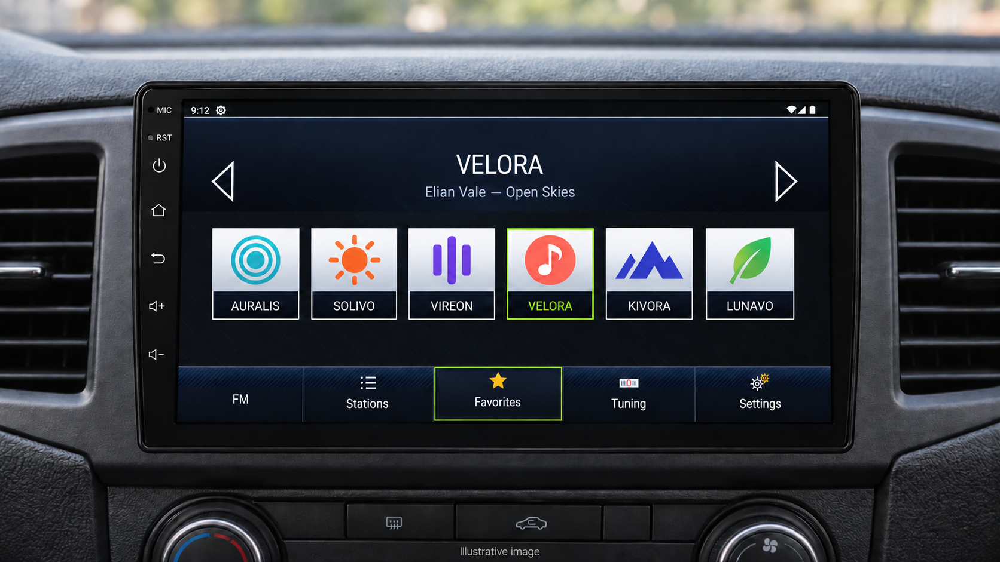

# Radio+

Free, open-source FM/AM radio tested on the **Junsun V7**, with favorites and custom logos.
May also work on other Chinese Android head units with a compatible stock radio service;
compatibility with those devices has not been verified.

**[Download community beta 5 — 0.16.1-dev36](https://github.com/edman01/radio-plus-open/releases/tag/v0.16.1-community-beta5)**

Beta 5 also includes [experimental radio profiles](docs/EXPERIMENTAL.md), including
K4811, G5 and SPD / Junsun V9 Plus. **Only the Junsun V7 has been confirmed on a
real head unit; the additional profiles remain unverified.**
[Supported models and limitations](docs/COMPATIBILITY.md#experimental-support).

*AI-assisted illustration with fictional stations and logos. Logos are not included in the app.*

## Compatibility

The community beta 5 download requires Android 8.1+ and a recognized stock radio service.
**Keep the stock radio installed and enabled.** Radio+ does not replace it or change the firmware.

On the tested Junsun V7, Radio+ controls the stock `com.hcn.autoradio` app through its **FMPlugService**.
Finding `com.hcn.autoradio` on your head unit is a promising compatibility clue:
Radio+ **may** work, but the package name alone is not a guarantee. The firmware
must still expose a compatible service/API.

Older HCN, TS, K4811 MCU, G5 MCU and SPD interfaces have **experimental support,
not yet tested on real head units**, in the same beta 5 APK. Each requires a
recognized stock implementation; a model name alone is not enough.
[Supported models and limitations](docs/COMPATIBILITY.md).

**Check your stock radio's package name (no PC needed):**

1. Open Android **Settings → Apps**, show all apps or system apps, then select
   the original **Radio** app and open **App info**. Menu names vary by firmware.
2. Look for the **package identifier**, not the display name “Radio” or the
   device's build number. Some firmware does not show it here; if yours does not,
   inspect the original Radio app with an already-installed app-information tool,
   such as DevCheck. The expected identifier is exactly `com.hcn.autoradio`.

You do not need to replace, disable or uninstall the stock radio to check this.
Optional, with an already-authorized ADB connection:
`adb shell pm list packages com.hcn.autoradio` should include `package:com.hcn.autoradio`.

**Tested and working on the maintainer's unit:**

| Detail | Reported specification |
| --- | --- |
| Device / model / board | Junsun V7 / `tb8768p1_64_bsp` |
| Chipset | MediaTek MT8768V/CX (reported as MT6765) |
| Memory / storage / display | 6 GB RAM / 128 GB storage / 1280 × 720 |
| Original tested firmware | `MQ001_2025.12.29.16.58_6_6826_G` |
| Original tested MCU | `MQ001-25.08.01_499` |
| Android on the original tested firmware | Android 13 (API 33), observed by DevCheck and diagnostics |
| Updated firmware, reported working with dev36 | `MQ001_2026.09.18.19.50` |
| Stock radio on the updated firmware | `com.hcn.autoradio` / `V.1.0.202609181544-mt8768-beta` |

On the original firmware, the OEM settings screen displays **Android 15**, while
DevCheck and diagnostics report **Android 13 / API 33**. This does not establish
the Android API level of the updated firmware.
The owner reports dev36 working after the firmware update; this is not a separate
confirmation of every feature. Support for the original firmware is retained.
Physical testing is limited to this unit. Other models and firmware variants
remain unverified, and not every feature is guaranteed.
See [test details and known issues](docs/TESTING.md).

## How it works

Radio+ provides an alternative interface for the head unit's built-in FM/AM tuner.
It sends tuning and playback commands to the compatible stock radio service,
which controls the radio hardware. It is not an internet radio player.

The original radio app must stay installed and enabled, but its interface does
not need to remain open. [How tuning, audio and station information work](docs/HOW_IT_WORKS.md).

## Community compatibility reports

Tried Radio+ on your head unit? [Report your results](https://github.com/edman01/radio-plus-open/issues/new?template=compatibility.yml)
or [browse user reports](https://github.com/edman01/radio-plus-open/issues?q=is%3Aissue%20label%3Acompatibility).
Include the model, firmware and what works or does not. Reports are user-submitted,
not a compatibility guarantee for every unit or firmware version.

Want support for another head unit? Its original radio APK or matching firmware
can help us investigate. Share an official download link or mention which files
are available; [see the support-request guide](docs/COMPATIBILITY.md#request-support).

## Known issues

Beta 5 retains the next/previous steering-wheel correction confirmed on the
original tested **Junsun V7 / Android 13** configuration: one press changes one
station, without the subsequent brief audio interruption. It also retains the
playback-continuity fix for reopening Radio+ while the radio is already playing.
Other head units and steering-wheel mute behavior still need separate verification.
[Details](docs/TESTING.md#known-issues).

## Using Radio+

Open **Tuning** to find stations. Hold a station to manage favorites, rename it or change its logo.

12 languages: English (default), Finnish, German, French, Spanish, Portuguese,
Italian, Swedish, Polish, Dutch, Turkish and Czech.
Choose yours in **Settings → General → Language**.

To import a logo: **Change logo → Add custom logo from device…** → choose a PNG/JPEG from USB or your device.
Use images you have permission to use. [Logo guide](docs/LOGOS.md).

[Install and update](docs/INSTALL.md) · [Build from source](docs/BUILD.md) · [Report a bug](CONTRIBUTING.md)

Independent project, not affiliated with Junsun or Škoda. Configure only while parked.
[MIT license](LICENSE) · [Privacy](docs/PRIVACY.md) · [Third-party notices](THIRD_PARTY_NOTICES.md)
